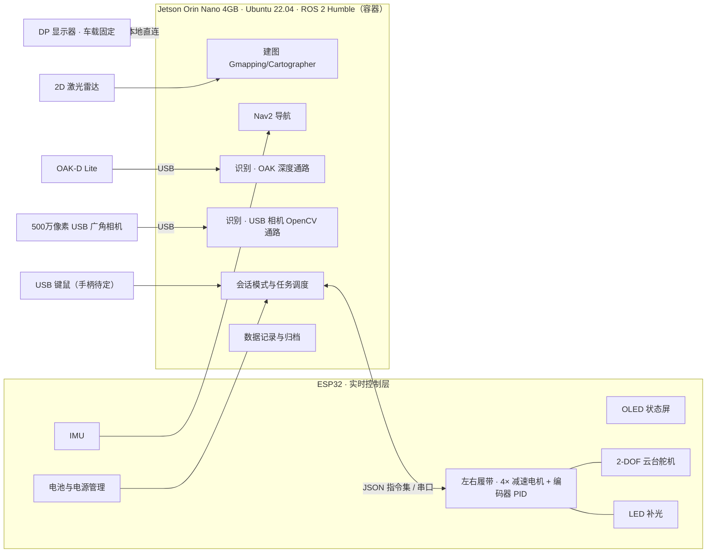
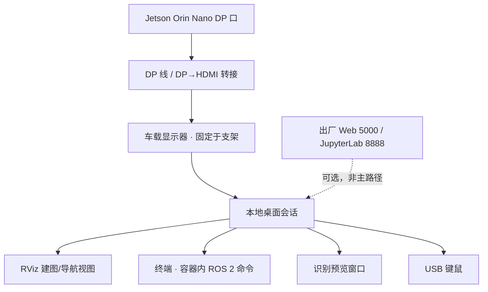
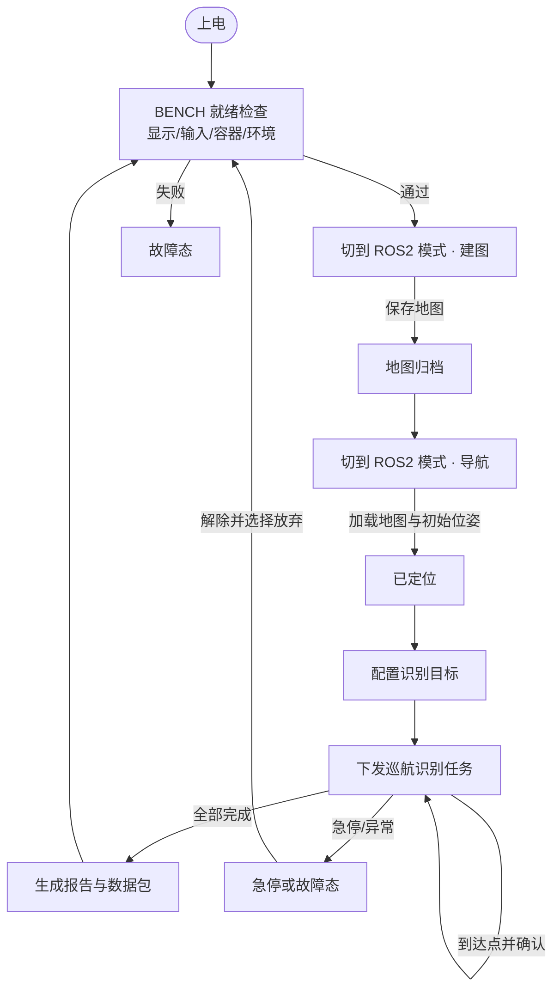

# 基于 ROS 2 Humble 的自主导航与目标识别系统 PRD

| 项目 | 内容 |
|---|---|
| 文档类型 | 产品需求文档（PRD） |
| 产品形态 | 教学与科研实验平台（单机版，本地直连） |
| 硬件基线 | Waveshare UGV Beast Jetson Orin ROS2 Kit |
| 平台基线 | Ubuntu 22.04 + ROS 2 Humble + Jetson Orin Nano 4GB |
| 访问方式 | **DP 接口外接显示器本地直连**（显示器随车固定，不使用 Web 控制台 / JupyterLab 远程访问） |
| 文档版本 | v0.3（履带底盘 + 车载屏幕校准稿） |
| 更新日期 | 2026-10-26 |

> **v0.3 变更**：底盘更正为**履带式**（此前误记为 6 轮）；DP 显示器确认为**随车固定**；USB 口确认为**已占满**（OpenCV 相机、OAK-D Lite、雷达、键鼠），手柄不再默认可用。相应地调整了底盘控制（差速/打滑/原地转向）、建图精度约束、车载屏幕与告警可见性、以及待确认问题。
>
> **v0.2 变更**：按厂商 wiki 校准硬件与软件基线（ESP32 JSON 指令集、OAK-D Lite、Gmapping/Cartographer + Nav2、`ugv_ws` 工作空间）；访问方式由"远程监控"改为 **DP 本地直连**，并新增"会话模式与资源互斥"（FR-02）。
>
> 本文定义平台"能做什么、在什么条件下做、做完留下什么证据"，不展开算法实现。`[Assumption, TBD]` 为待评审确认的建议值，`[TBD]` 为尚缺信息。

---

## 0. 硬件与软件基线

### 0.1 硬件清单（厂商 wiki 确认项）

| 部件 | 规格 | 来源 |
|---|---|---|
| 底盘 | **履带式越野底盘（左右两条履带，非轮式）**，左右履带各由 2 个带编码器减速电机驱动（共 4 个），闭环速度控制，独立悬挂，2mm 全铝车身；厂商标称最高 1.3 m/s | 用户确认 + 厂商 wiki |
| 行走特性 | 履带接地面积大、过门槛与越障能力强；代价是转向阻力大、在光滑地面（瓷砖/环氧地坪）易打滑，里程计误差需靠标定与打滑监测控制 | 产品判断 |
| 下位机 | ESP32，负责电机 PID、IMU、OLED 屏、2-DOF 云台舵机、LED 开关；对上位机提供 JSON 指令集 | 厂商 wiki |
| 上位机 | Jetson Orin Nano 4GB（用户确认），Ubuntu 22.04，预装 ROS 2 Humble，Docker 容器内运行 ROS 2 工作空间 | 厂商 wiki + 用户 |
| 2D 激光雷达 | 360° 2D 雷达，具体型号与量程待确认 | `[TBD]` |
| 深度相机 | OAK-D Lite，ROS 2 驱动 `ugv_vision`，图像话题 `/oak/rgb/image_rect` | 厂商 wiki |
| 视觉相机 | 500 万像素 160° 超广角 USB 相机 + 2-DOF 云台 + 高亮 LED 补光；OpenCV 教程以 `cv2.VideoCapture` 取流，640×480 | 厂商 wiki |
| 电源 | 3S 18650 锂电池 ×3，UPS 模块支持边充边用，充电器 12.6V/2A | 厂商 wiki |
| 交互外设 | **USB 口已占满**：OpenCV USB 相机、OAK-D Lite、激光雷达、键盘鼠标各占 1 个；出厂 Xbox 手柄接收器无空闲口，需蓝牙手柄或 USB HUB 才能使用 `[TBD]`；`MANUAL` 模式默认以键鼠为主 | 用户确认 |
| 显示 | **DP 外接显示器已随车固定**（车载支架），DP 线缆与显示器供电随车走线并固定 | 用户确认 |

### 0.2 软件基线

| 项 | 内容 |
|---|---|
| 工作空间 | `/home/ws/ugv_ws`（ROS 2 容器内，容器账号 root/jetson） |
| 关键功能包 | `ugv_bringup`（底盘+雷达启动）、`ugv_tools`（手柄/键盘遥控）、`ugv_slam`（Gmapping / Cartographer）、`ugv_nav`（Nav2 + 地图保存）、`ugv_vision`（OAK-D Lite）、`ugv_gazebo`（仿真）、`explore_lite`（自动探索） |
| 建图 | `ros2 launch ugv_slam gmapping.launch.py use_rviz:=true` / `cartographer.launch.py` |
| 导航 | `ros2 launch ugv_nav slam_nav.launch.py use_rviz:=true`，RViz 内 Nav2 Goal 下发目标 |
| 地图落盘 | `save_2d_gmapping_map.sh` → `nav2_map_server map_saver_cli -f ./map`，产出 `map.pgm` + `map.yaml`，存于 `src/ugv_main/ugv_nav/maps` |
| 出厂主程序 | Flask + Python 的 Web 主程序（5000 端口）+ JupyterLab（8888 端口），开机经 crontab 自启，**常驻占用相机资源** |
| 出厂网络 | AP 热点 AccessPopup（192.168.50.5），USB 虚拟网口 192.168.55.1，系统账号 jetson/jetson |

> 出厂设计以"浏览器远程访问"为主路径。本项目改为 DP 本地直连后，Web 主程序与 JupyterLab 不再是必需组件，但它们**对相机资源的独占**必须被显式管理——这是本版新增 FR-02 的直接原因。

---

## 1. 背景与目标

### 1.1 问题

1. **访问方式与实验内容错配**：出厂方案要求学生用手机/笔记本连热点、开浏览器进 Web 控制台，再开 JupyterLab 跑代码。实验现场没有稳定网络，浏览器标签页切走后手柄控制失效、视频解码卡顿，学生把大量时间花在"能不能连上"而不是"算法对不对"。
2. **资源争抢导致"莫名其妙失败"**：厂家主程序开机即占用 USB 相机，而 OpenCV 实验必须杀掉它才能取到画面（wiki 明确要求 `sudo killall -9 python`）；同时 ROS 2 跑在 Docker 容器里、建图与导航又各自有 launch 入口。学生并不知道当前是谁占着相机、谁占着串口，失败被误判成算法问题。
3. **实验过程不可追溯**：地图、参数、任务轨迹、识别结果分散在容器、脚本、RViz 截图里，课后无法复现，也无法评分。

### 1.2 产品判断

以 **DP 本地直连**为一等公民重新组织实验流程：开机即进入本地实验台（桌面 + RViz + 终端 + 识别预览窗口），所有会争抢相机/串口/底盘控制权的东西被统一纳入"**会话模式**"管理，任一时点只有一个持有者；实验结束自动产出"地图 + 参数快照 + 数据包 + 任务报告"四件套存档。

### 1.3 目标（可观察结果）

| 编号 | 目标 | 可观察的达成标志 |
|---|---|---|
| G-01 | 开机即用，不依赖网络 | 接通 DP 显示器、上电后，无需连热点、无需浏览器，即可在本地桌面启动建图或导航 |
| G-02 | 资源争抢可见可控 | 任何时刻界面上都能看出"当前谁在控制底盘、谁在占用相机"，模式切换不会留下半死不活的进程 |
| G-03 | 一次实验可独立完成 | 学生从开机到拿到"任务报告 + 数据包"全程不需要教师改代码或手工杀进程 |
| G-04 | 实验可复现 | 用归档的数据包与参数快照重放，识别结果与任务结论一致 |
| G-05 | 跨模块闭环可见 | 识别到的目标可转为导航目标点，机器人自主抵达并在本地屏幕二次确认 |
| G-06 | 安全可控 | 任意时刻急停或断电，底盘停止、任务上下文不丢，重启后能看出"上次停在哪一步" |

> 量化指标见 §7，均为 `[Assumption, TBD]`，首轮样机测试后冻结。

---

## 2. 用户与角色

| 角色 | 典型身份 | 核心诉求 | 平台内权限 |
|---|---|---|---|
| 实验者（学生） | 本科生 / 研究生 | 在车旁用本地屏幕完成建图、导航、识别，拿到可提交的产物 | 切换会话模式、建图、下发任务、触发识别、导出本次实验产物 |
| 指导教师 | 授课教师 / 导师 | 布置实验、核对过程数据、复现学生失败场景 | 实验者全部权限 + 编辑参数集模板 + 回放任意数据包 + 删除归档 |
| 平台维护者 | 实验室工程师 | 标定、固件与工作空间版本管理、故障定位 | 系统配置、标定、日志诊断、固件/容器升级、故障复位 |

> 单机场景不做账号体系：身份以"本地登录会话 + 模式选择"落地，权限差异只体现在**能否改参数集模板**与**能否删归档/改系统配置**两类动作。

---

## 3. 范围

### 3.1 P0（首个可交付版本必须完整）

最小完整旅程：**上电 → DP 本地实验台就绪 → 切到建图模式并保存地图 → 切到导航模式加载地图定位 → 配置识别目标 → 下发"巡航并识别"任务 → 回收报告与数据包**。

- 本地实验台启动与就绪检查（显示、输入设备、桌面布局、容器与环境）
- 会话模式与资源互斥管理（底盘主程序 / ROS 2 实验 / OpenCV 实验）
- 底盘运动控制、底盘反馈、云台与 LED 控制
- 急停与安全保护
- Gmapping 建图（Cartographer 作为可选算法）、地图保存与管理
- Nav2 定位、单点导航、多点巡航、自动探索（封闭区域）、恢复行为
- OAK-D Lite 深度通路与 USB 广角相机 OpenCV 通路的目标识别
- 识别结果的地图坐标化与"转为导航目标点"
- 数据记录与回放
- 参数集与实验模板
- 本地诊断与日志

### 3.2 P1（P0 稳定后再做）

- 出厂 Web 控制台（5000）与 JupyterLab（8888）在本地模式下的可选保留/裁剪
- 3D 建图（基于深度相机）作为独立实验模块
- Gazebo 仿真预演（在本地桌面跑，用来预演巡航路线）
- 语义地图（识别目标写入地图层）
- 局域网内第二块屏幕/平板做"观察端"（只读，不控制）
- 自动回充、多机同场实验

### 3.3 明确不做

- 依赖互联网的远程控制（Pgyer/Cpolar/LocalTunnel 等内网穿透方案）
- 室外越野、非结构化地形长距离通行
- 机械臂抓取等操作类任务
- 车规级功能安全认证（按教学设备安全要求设计）

---

## 4. 系统总览与核心流程

### 4.1 硬件拓扑

**分层职责**

- 上位机：感知、建图、规划、识别、任务编排、数据归档，以及"谁在控制机器人"的唯一裁决者。
- 下位机：电机 PID、编码器、IMU、OLED、云台舵机、LED、电源状态；不做任何规划或识别。
- 上下位机之间只有一条逻辑链路；链路中断视为系统级故障（§6.4）。

### 4.2 本地访问拓扑（本项目与出厂方案的差异）

**访问方式的产品级约束**

| 约束 | 内容 |
|---|---|
| 不依赖网络 | 关闭热点与 Web 主程序后，本地建图、导航、识别、归档全部可用 |
| 单屏可完成 | 1920×1080 单屏下，RViz、终端、识别预览三者可切换或分区共存，不需要第二块屏 |
| 输入设备 | USB 口位固定为：OpenCV 相机 / OAK-D Lite / 激光雷达 / 键鼠各一，已无空闲口；插错口位会导致枚举失败，界面按口位提示重插；Xbox 手柄暂无可用口 `[TBD]` |
| 显示器摆放 | 显示器随车固定在车载支架上，**操作者需跟车观察**；观看距离约 0.5–1 m，字号与 RViz 布局按此距离设计 |
| 行驶中的屏幕 | 车体运动时屏幕有震动与反光，A/B 级告警与关键状态必须配独立声光，不得只依赖屏幕文字；行驶中禁止用小按钮操作 |
| 线缆 | DP 线与显示器供电线随车固定，行驶前确认无垂落；线缆受拉立即停车检查 |
| 上电时序 | 显示器与 Jetson 供电相互独立，先开显示器再上电 Jetson；断电时先停任务再断电 |

### 4.3 会话模式（本版核心模型）

出厂软件里，底盘主程序、ROS 2 驱动节点、OpenCV 脚本会**互相抢相机与串口**。本版把它们抽象成三种互斥的会话模式：

| 模式 | 谁在控制底盘 | 谁占相机 | 与本地屏幕的关系 | 典型用途 |
|---|---|---|---|---|
| `BENCH`（默认） | 无人，底盘锁定 | 无人占用 | 桌面 + 终端就绪 | 开机检查、改代码、看日志 |
| `ROS2` | `ugv_bringup` 驱动节点 | OAK-D Lite（USV/`ugv_vision`） | RViz 主视图 | 建图、导航、深度识别 |
| `OPENCV` | 底盘锁定（可由脚本按规则移动） | USB 广角相机（`/dev/video*`） | 识别预览窗口主视图 | 颜色/巡线/运动检测类实验 |
| `MANUAL` | 键鼠（手柄若可用） | 可选 OAK 图传 | RViz + 键鼠 | 建图时人工遥控、现场调试 |

**转换规则（唯一裁决点）**

1. 进入任一模式前，先释放上一模式的底盘控制权与相机占用；释放动作必须**可验证**（相机句柄关闭、驱动节点已退出）。
2. 模式切换时底盘必须先停稳；`MANUAL` 与 `ROS2` 互斥（不能一边 Nav2 一边人工抢控制）。
3. 切换失败（旧进程杀不掉、相机仍被占）时，系统停在 `BENCH` 并给出"占用者是谁 + 建议动作"，不允许带病进入新模式。
4. 出厂主程序是常驻多线程 + crontab 自启，普通 `killall` 无效。产品必须提供**一键彻底停止（并临时禁用自启）**与**恢复自启**两个动作，且状态在界面上可见。

### 4.4 核心旅程

**完成证据**：报告含逐点到达状态、位姿误差、识别结果（类别、置信度、地图坐标、截图）、异常时间线，并与一份可回放数据包一一对应。

---

## 5. 功能需求

> 每项按"目的 / 触发 / 处理规则 / 结果与状态变化 / 异常与恢复"描述。速度与时限类具体值见 §7。

### 5.1 本地实验台就绪（FR-01）

**目的**：让"接上 DP 线、上电"成为一次确定的开始，而不是一场接线与登录的搏斗。

**触发**：Jetson 上电；或从故障态复位后由操作者点击"重新就绪检查"。

**处理规则**

1. 依次检查：DP 输出的分辨率与刷新是否有效 → 输入设备（键鼠是否识别，手柄作为可选设备）→ 磁盘余量 → ROS 2 容器可进入 → 工作空间可加载 → 四路 USB 设备（OpenCV 相机 / OAK-D Lite / 雷达 / 键鼠）按下发口位稳定枚举 → 下位机串口是否存在。
2. 每项给出 `通过 / 警告 / 失败`；`警告` 不阻断（如手柄未连、电量偏低），`失败` 阻断进入 `BENCH`。
3. 显示器无信号或无桌面时，在 OLED 状态屏上给出提示（出厂 OLED 已被用于显示 IP，本版改为显示"状态短语"），便于无屏幕时排查。
4. 就绪检查耗时上限 `[Assumption, TBD]`，超时项按失败处理并指名。

**结果与状态变化**：`BOOT → SELF_TEST → BENCH` 或 `→ FAULT`；结果清单在本地界面保留可回看，并写入会话日志。

**异常与恢复**：单项失败给出"可能原因 + 建议动作"（相机失败 → 检查 USB 口是否被主程序占用；雷达失败 → 检查供电与串口权限）；USB 设备反复重新枚举或插错口位 → 按 §0.1 固定口位提示重插并自动复查该项；允许单独"重新检查该项"，不必重启整机。

---

### 5.2 会话模式与资源互斥（FR-02）

**目的**：把"为什么我这边取不到相机画面"从猜谜变成一条明确提示。

**触发**：操作者在模式切换器上选择目标模式；或直接启动某个实验（系统按该实验需要的模式自动请求切换）。

**处理规则**

1. 系统维护一张资源占用表：`底盘控制权`、`USB 广角相机`、`OAK-D Lite`、`下位机串口`、`显示主视图`。每个资源同一时刻只有一个持有者。
2. 切换流程固定为：**停车 → 释放旧持有者 → 校验释放 → 建立新持有者 → 校验就绪 → 报告切换结果**。
3. 校验释放的方式必须是"可观测的"：相机句柄确实关闭、驱动节点确实退出、串口确认无占用；不得仅凭进程 kill 指令返回成功就判定释放。
4. 对出厂主程序提供"彻底停止"（停进程 + 临时禁用自启）与"恢复自启"两个动作，动作结果显示在模式面板上。
5. 模式切换不改变系统状态机的大状态（仍是 `BENCH` 或 `RUNNING`），但会记录一次"模式变更事件"。
6. 任何模式切换都不得清空当前已加载地图、参数集与未归档数据。
7. USB 物理口位在整机装配时固定，模式切换只改变软件层的占用关系；不允许使用者为省事拔插换口，需要换设备时先回到 `BENCH`。

**结果与状态变化**：产生模式变更事件（时间、来源模式、目标模式、耗时、结果）；模式面板常驻显示当前模式与各资源持有者。

**异常与恢复**

| 异常 | 处理 |
|---|---|
| 旧进程反复无法退出 | 停留在 `BENCH`，标记失败并提示"建议重启机器人"；不自动强杀整机 |
| 相机仍被占用 | 提示占用者名称（主程序 / 其他脚本 / 上次异常退出残留），提供"重试释放" |
| 切换中底盘未停稳 | 中止切换，先执行停车再重试 |
| 切换后外设不可用（OAK 未识别） | 停在 `BENCH` 并标记该资源不可用，允许在"仅导航"场景继续（不使用深度通路） |

---

### 5.3 底盘运动控制（FR-03）

**目的**：上层模块用同一种方式驱动底盘，底盘行为对站在车旁的学生是可预测的。

**触发**：收到速度指令（`MANUAL` 的手柄/键盘、`ROS2` 的导航输出、`OPENCV` 巡线脚本按规则给出的速度）；或收到停车指令。

**处理规则**

1. 速度指令按**履带差速**模型解释并下发下位机（左右履带速度差决定转向）；超过该模式限速的指令被**限幅**而非拒绝，界面提示"已限速"。
2. 连续 `[Assumption, TBD]` 毫秒无新指令自动减速停车（失联保护）。
3. 停车指令优先级最高，不排队、不等待当前动作结束。
4. 底盘持续回传：左右轮实际速度、累计里程、IMU 姿态、电池电压/电流、急停状态；这些量同时供导航定位与界面显示使用。
5. 三种模式的限速不同：建图/巡航/靠近识别目标三档，靠近目标时强制降档 `[Assumption, TBD]`。
6. 厂商标称最高 1.3 m/s，产品**默认不超过**实验限速档位，只有维护者可在参数集中放开。
7. 履带允许原地转向（左右反向），但会刮擦地面：仅在低速档且参数集开放时可用，地毯与光滑地面默认禁止 `[Assumption, TBD]`。
8. 里程计标定状态必须可见：未标定或标定过期时，建图与导航启动前给出警告；运行中检测到里程突增或位姿跳变（疑似打滑）时记录"打滑事件"并提示。

**结果与状态变化**：底盘状态在 `停止 / 运动 / 限速运动 / 失联保护 / 急停` 间切换，每次切换记录时间戳与来源（手柄、键盘、导航、脚本、保护）。

**异常与恢复**

| 异常 | 表现 | 处理 |
|---|---|---|
| 编码器无反馈 | 有指令无里程 | 立即停车，标记"驱动异常"，拒绝新指令直到复位 |
| 堵转/过流 | 电流超阈 | 停该轮输出并上报，提示检查履带是否卡阻或缠绕异物 |
| 履带打滑 | 里程突增、位姿跳变、路径跟踪抖动 | 记录打滑事件；导航中自动降速并提示；建图中建议降低速度或换地面后重来 |
| 串口链路中断 | 心跳丢失 | 下位机自身执行停车；上位机进入故障态 |
| 电量低于保护阈值 | 电压低告警 | 禁止开始新任务，仅允许"返回起点"类短动作 `[Assumption, TBD]` |

---

### 5.4 云台与补光控制（FR-04）

**目的**：识别不是"车正好对着目标"，而是能主动去看。

**触发**：操作者在识别会话中手动调整；或识别流程按扫描策略自动调整；或建图/导航开始时云台回中。

**处理规则**

1. 云台两自由度（水平/俯仰）各有安全角度范围，越界指令被限幅并提示。
2. 提供三个快捷位姿：**回中（正前方）**、**俯视（近处地面）**、**抬头（远处目标）**；建图与导航启动时强制回中。
3. 扫描模式：在设定角度范围内按固定步进扫描，每停留一帧输出一次识别结果；扫描中不允许底盘高速移动 `[Assumption, TBD]`。
4. LED 补光可按环境亮度手动开关；识别会话可配置"低照度自动开灯"。
5. 云台运动不得触发急停判定，但云台指令与底盘指令同时下发时不得互相阻塞 `[Assumption, TBD]`。

**结果与状态变化**：云台位姿与 LED 状态在界面可见，并在识别结果中记录"采集时的云台位姿"，用于复现同一视角。

**异常与恢复**：云台无响应 → 标记该自由度不可用，识别仍可在固定视角继续；云台卡死 → 提示并禁止扫描模式。

---

### 5.5 SLAM 建图（FR-05）

**目的**：产出一张"下次导航真能用"的地图，而不是一张只能看的截图。

**触发**：在 `ROS2` 模式、待机状态下点击"开始建图"，填写地图名称并选择算法（Gmapping 默认 / Cartographer 可选）。

**处理规则**

1. 建图前校验：已加载地图为空、导航未运行、底盘处于停止、雷达数据正常、里程计标定状态为"已标定"（未标定仅警告并要求确认，因为履带打滑会直接放大建图误差）、地面为地毯或防滑地胶 `[Assumption, TBD]`。
2. 建图过程中本地 RViz 显示：实时地图、机器人位姿、雷达点云、覆盖区域；同时显示本次已行进距离与建图时长。
3. 地图名称必填且不可重名；重名时提供"覆盖 / 改名 / 取消"，覆盖需二次确认。
4. 支持暂停（保留已建部分）与继续。
5. 结束建图时执行闭合检查：标出未覆盖区域与明显墙体断裂，允许"仍然保存"。
6. 保存动作沿用厂商落盘方式（生成 `map.pgm` + `map.yaml`），并由平台额外生成：建图参数快照、建图过程数据包、地图缩略图。
7. 建图过程中允许 `MANUAL` 接管遥控，但接管期间为 `MANUAL` 模式，退出后回到建图会话。

**结果与状态变化**：`BENCH → MAPPING → BENCH`；生成一条地图记录（名称、创建人、时间、算法、参数快照、数据包、缩略图、覆盖面积 `[Assumption, TBD]`）。

**异常与恢复**：雷达掉线 → 暂停并提示，恢复后可继续；建图中途退出 → 弹"保存当前地图 / 放弃"，禁止静默丢弃；磁盘不足 → 提前告警并阻止开始建图；因打滑出现墙体重影或错位 → 提示并建议降到最低速档、减少原地转向后重新建图（不允许把已错位的地图直接当"可用地图"保存）。

---

### 5.6 地图管理（FR-06）

**目的**：多组学生、多次实验的地图互不污染。

**触发**：进入地图列表；或任务下发时选择地图。

**处理规则**

1. 每张地图携带：名称、创建人、创建时间、算法、来源建图会话、参数快照、缩略图、校验值。
2. 支持"设为默认"；默认地图在启动后自动加载用于定位。
3. 删除需二次确认；被历史报告引用的地图只允许"归档"，不允许删除。
4. 地图文件损坏或与参数快照不匹配时标记"不可用"，禁止用于导航。
5. 地图目录沿用厂商约定的存放位置，保证厂商原有脚本仍可正常保存与读取。

---

### 5.7 定位与导航（FR-07）

**目的**：把"去某个位置"变成有明确开始、明确结束、可判定成败的任务。

**触发**：加载地图后系统进入"已定位"；随后由操作者在本地 RViz 转发目标点，或用巡航面板下发点列。

**处理规则**

1. 定位未就绪（初始位姿未确认或置信度低）时禁止下发任务，本地界面给出"请在 RViz 用 2D Pose Estimate 确认初始位姿"的引导。
2. 两种任务形态：**单点**（RViz 直接下发）与**巡航**（顺序走多点，每点可配停留时长、是否执行识别、是否调整云台）。
3. 执行中本地显示：全局与局部路径、当前位置、剩余距离、当前点序号、预计剩余时间。
4. 支持暂停（原地保持、保留上下文）、继续、取消；取消后原地停车并保留已完成点位记录。
5. 到达判定：位置误差与朝向误差同时满足阈值才算到达；仅位置满足时标记"到达但朝向偏差"，允许继续下一目标点并记录。
6. 自动探索仅在**封闭区域**开放（沿用厂商 `explore_lite`），启动前要求使用者确认"场地已封闭"，探索中禁止下发手动目标；探索结束自动进入"保存地图"引导。
7. 持续阻塞时按恢复升级链处理（§6.5），全过程对使用者可见，不允许"卡住不动但显示运行中"。

**结果与状态变化**：任务状态 `PENDING → RUNNING → (PAUSED) → SUCCEEDED / ABORTED / FAILED`；每个目标点独立记录到达状态、耗时、误差。

**异常与恢复**

| 异常 | 处理 |
|---|---|
| 目标点在地图外或障碍物内 | 下发前校验并拒绝，提示"目标点不可达" |
| 定位丢失 | 暂停任务并引导重定位；超时未恢复置为失败并保留轨迹 |
| 导航节点崩溃/无响应 | 立即停车，任务置失败，记录诊断 |
| 巡航中途电量不足 | 提示并建议"返回起点后结束"，由使用者决定 |
| 自动探索中进入开放区域 | 立即停止探索并提示"场地未封闭"，不继续扩张 |

---

### 5.8 目标识别（双通路）（FR-08）

**目的**：明确两条识别通路各自的边界，避免"OpenCV 实验"和"深度识别"互相踩脚。

**触发**：操作者选择识别实验（颜色识别 / 运动检测 / 巡线 / 自定义 OpenCV 脚本；或深度目标识别），系统自动请求对应会话模式。

**处理规则**

1. **OpenCV 通路（`OPENCV` 模式）**：使用 USB 广角相机取流，分辨率为约定值（默认 640×480），在本地独立预览窗口中显示，叠加识别框与参数。识别阈值（颜色 HSV 区间、最小目标尺寸、运动灵敏度等）由参数集提供，可现场调整并即时生效。
2. **深度通路（`ROS2` 模式）**：使用 OAK-D Lite，输出类别、置信度、图像包围框、深度距离、地图坐标、截图。深度无效时降级为仅二维并显式标注。
3. 两条通路**不可同时运行**（相机资源与显示主视图互斥）；切换时按 FR-02 流程执行。
4. 巡线类实验按约定规则直接给出底盘速度（属于 `OPENCV` 模式下的受控移动），必须具备"丢失巡线即停车"的行为，不允许丢失后继续按最后指令行驶。
5. 同一目标在短窗口内重复检出合并为一条记录，置信度取最大值并累计检出次数。
6. 目标可"确认"：确认后的深度目标可一键转为导航目标点或加入巡航点列；仅二维目标不可转导航。

**结果与状态变化**：识别会话 `未启动 / 运行中 / 已结束`；目标记录 `新检出 / 已确认 / 已忽略 / 已用于导航`。

**异常与恢复**

| 异常 | 处理 |
|---|---|
| 相机被主程序占用 | 不进入会话，直接提示占用者并提供"彻底停止主程序"入口 |
| 帧率过低或画面卡住 | 会话暂停并提示；已检出记录保留 |
| 深度与 RGB 对齐失败 | 全部目标降级二维，界面显著提示 |
| 强逆光/暗场导致误检 | 记录"图像质量低"标记，报告中单列，供教师判断剔除 |
| 巡线丢失 | 立即停车，会话暂停，等待人工干预 |
| 已确认目标位于障碍物内 | 转导航前校验并拒绝 |

---

### 5.9 目标三维定位与"转导航"（FR-09）

**目的**：让识别结果成为可执行的导航意图，而不是一张标了框的图。

**触发**：深度通路输出有效目标；操作者点击"转为导航目标"。

**处理规则**

1. 目标位姿必须换算到 `map` 坐标系；换算依赖"目标在相机系下的深度位置 + 当时机器人位姿 + 云台角度补偿"。
2. 换算结果附带误差估计；误差估计超过阈值时仍可展示，但"转导航"按钮置灰并说明原因 `[Assumption, TBD]`。
3. 转导航时自动生成一个导航目标点，并在 RViz 中以独立标记显示；目标点与识别记录双向可追溯（报告里能看到"这个点来自哪张图"）。
4. 抵达目标点后执行**二次确认**：重新对准并识别，确认同一类别目标存在；确认失败时标记"目标未复现"，任务继续或中止由参数集规定。

**结果与状态变化**：识别记录状态变为"已用于导航"，并生成一条关联的任务点位记录。

**异常与恢复**：换算失败 → 该目标禁止转导航并提示原因；抵达后二次确认失败 → 记录并继续下一目标，不重复尝试超过 `[Assumption, TBD]` 次。

---

### 5.10 任务编排与报告（FR-10）

**目的**：把一次实验收敛成一份能交的产物。

**触发**：巡航任务结束、失败或被取消时自动生成。

**处理规则**

1. 报告包含：任务基本信息（地图、参数集、会话模式、操作者、起止时间）、逐点结果（到达状态、误差、耗时、云台位姿）、识别清单（截图、地图坐标、置信度）、异常时间线、数据包引用。
2. 报告与数据包成对归档，目录按"日期-地图名-任务名-操作者"命名。
3. 支持导出为通用文档格式 `[Assumption, TBD]`；导出内容与本地界面展示一致。
4. 取消或失败的任务同样生成报告，并明确标注中止原因。

**结果与状态变化**：产生归档记录 `未归档 / 已归档 / 已删除`；归档后默认只读，补充说明以附注追加。

---

### 5.11 数据记录与回放（FR-11）

**目的**：支撑"失败可复现"这一教学与科研的硬需求。

**触发**：建图会话、导航任务、识别会话开始/结束时自动分段；也可手动自由记录。

**处理规则**

1. 记录内容至少含：激光数据、OAK 图像与深度（若该模式启用）、USB 相机画面（若该模式启用）、里程计与 IMU、速度指令与实际速度、云台角度、任务与模式事件、识别结果。
2. 分段命名与任务绑定，使用者一眼能看出"这段数据属于哪次任务"。
3. 回放支持：完整回放、仅事件回放、按时间区间裁剪。
4. 回放默认只读，不向真实底盘发运动指令；切到"贯通模式"必须先满足"底盘停止且急停未解除"。
5. 记录容量上限可配置，超限提示清理"最旧未归档"，不静默删除。
6. 若使用厂商容器，记录与回放须在容器内可用，且归档目录对本地桌面可见（便于拷贝）。

**结果与状态变化**：数据包 `记录中 / 已完成 / 已损坏`；损坏包在列表中标注并禁止回放。

**异常与恢复**：掉电或磁盘满导致中断 → 下次启动扫描并提示"发现未完成数据包，可尝试修复"，修复失败标记损坏。

---

### 5.12 参数集与实验模板（FR-12）

**目的**：让教师改一次、全班生效，同时不锁死学生的探索空间。

**触发**：教师创建/编辑；学生加载使用。

**处理规则**

1. 参数集覆盖：限速档位、导航阈值与恢复次数上限、识别阈值（HSV 区间、最小尺寸、置信度）、云台扫描步进、记录开关与容量。
2. 分两类：**模板**（教师维护，学生只读）与**个人副本**（学生复制后可改，不影响他人）。
3. 任务前必须绑定参数集；报告记录实际生效快照，模板后续被改也不影响历史报告。
4. 修改需"应用"才生效，应用时校验取值范围，越界拒绝并提示合法区间。
5. 支持"一键复位到模板默认"，需二次确认。
6. 参数集与厂商原有 YAML 配置并存时，以参数集为准并生成可读的推导说明 `[Assumption, TBD]`。

**结果与状态变化**：参数集 `草稿 / 已发布 / 已停用`；仅 `已发布` 可被学生选择。

---

### 5.13 本地诊断与日志（FR-13）

**目的**：把"跑不动了"从一句抱怨变成一条可定位的记录。

**触发**：进入诊断面板；或发生 A 级告警时自动记录。

**处理规则**

1. 面板展示：各模块与设备在线状态、最近心跳、CPU/内存/磁盘、整机温度、电池趋势、当前模式与资源持有者、最近 20 条事件。
2. 日志按会话归档，可按时间与关键字检索。
3. 支持"导出诊断包"（日志 + 配置快照 + 版本信息），用于向维护者报障。
4. 维护者可查看固件版本、容器镜像与工作空间版本，并记录每次升级动作。

**结果与状态变化**：告警进入事件时间线，并保留在本次任务报告中。

---

## 6. 共享规则与异常

### 6.1 坐标与单位

| 坐标系 | 含义 | 使用者 |
|---|---|---|
| `map` | 全局地图系，长期稳定 | 定位、导航目标点、识别目标位姿 |
| `odom` | 里程计连续系，无跳变 | 局部规划、速度平滑 |
| `base_link` | 车体中心 | 底盘控制 |
| `laser_link` / `oak_link` / `gimbal_link` | 传感器与云台安装系 | 建图、深度识别、云台补偿 |

- 对外展示的位置一律用 `map` 系，单位米/弧度；同时给出"距起点距离"作直观参考。
- 识别目标必须换算到 `map` 才可参与导航；换算失败则该目标不可用。

### 6.2 状态机

| 状态 | 允许的操作 | 可进入的下游状态 |
|---|---|---|
| `BOOT` / `SELF_TEST` | 仅查看 | `BENCH`、`FAULT` |
| `BENCH` | 模式切换、加载地图、建图、下发任务、标定 | `MAPPING`、`RUNNING`、`FAULT` |
| `MAPPING` | 暂停/继续/保存/放弃、临时 `MANUAL` 接管 | `BENCH`、`FAULT` |
| `RUNNING` | 暂停/继续/取消、急停、模式内切换云台 | `BENCH`、`ESTOP`、`FAULT` |
| `ESTOP` | 解除急停、查看状态 | `RUNNING`（恢复）、`BENCH`（放弃） |
| `FAULT` | 查看诊断、导出诊断包、复位（维护者） | `SELF_TEST` |

**互斥约束**：`MAPPING` 与 `RUNNING` 互斥；同一时刻只允许一个识别会话运行；同一时刻只允许一个导航任务处于 `RUNNING`；`MANUAL` 与导航自动驾驶互斥。

### 6.3 资源争用矩阵

| 资源 | `BENCH` | `MANUAL` | `ROS2` | `OPENCV` |
|---|---|---|---|---|
| 底盘控制权 | 无人（锁定） | 键鼠（手柄若可用） | 驱动节点（导航或遥控） | 脚本（仅巡线类） |
| USB 广角相机 | 空闲 | 空闲 | 空闲 | **占用** |
| OAK-D Lite | 空闲 | 可选图传 | **占用** | 空闲 |
| 下位机串口 | 空闲 | 驱动节点 | 驱动节点 | 脚本或驱动节点（二者择一） |
| 显示主视图 | 桌面 | RViz | RViz | 识别预览 |

### 6.4 安全规则

| 规则 | 内容 |
|---|---|
| 急停来源 | 物理急停、本地界面急停、碰撞/堵转保护、串口失联保护；等效，均置 `ESTOP` |
| 急停响应 | 切断电机输出并以最大减速度停车，抱死直至人工解除 |
| 解除条件 | 触发源消除 + 人工确认；解除后不自动恢复任务，须选择"恢复"或"放弃" |
| 速度分级 | 建图 / 巡航 / 近目标三档；`OPENCV` 巡线另有独立限速档 |
| 失联保护 | 上位机与下位机心跳超时由下位机独立执行停车，不依赖上位机存活 |
| 禁止动作 | 定位未就绪禁导航；`ESTOP` 期间禁止任何运动指令；仅二维目标禁转导航；模式切换未完成禁止动底盘 |
| 原地转向 | 履带原地转向会刮擦地面，仅在低速档且参数集开放时可用；地毯与光滑地面默认禁止 |
| 车载屏幕可见性 | A/B 级告警必须同时有独立声光，不依赖随车屏幕被看到；行驶中禁止依赖屏幕小按钮操作 |
| 屏幕与线缆 | 随车显示器与 DP/供电线必须固定，行驶前确认无垂落；线缆受拉时立即停车检查 |
| 断电顺序 | 先取消任务并停车，再断电源；开机先开显示器 |

### 6.5 导航恢复升级链

| 级别 | 行为 | 超时后 | 可见性 |
|---|---|---|---|
| R1 | 原地等待障碍消失 | 升级 R2 | 显示"等待通行"与倒计时 |
| R2 | 局部绕行（有限幅度） | 升级 R3 | 显示绕行路径 |
| R3 | 重新规划全局路径 | 升级 R4 | 显示新旧路径对比 |
| R4 | 任务失败并停车 | — | 明确告知失败原因与失败点位姿 |

每级次数上限由参数集控制；同一点连续失败达上限后，巡航按参数集规则"跳过该点"或"整体失败" `[Assumption, TBD]`。

### 6.6 告警分级

| 级别 | 含义 | 表现 | 对任务影响 |
|---|---|---|---|
| A | 安全相关 | 声光 + 界面强提示 + 事件记录 | 立即停车 / 进入急停 |
| B | 功能降级 | 界面提示 + 事件记录 | 可继续但受限（深度无效、云台不可用） |
| C | 信息 | 仅事件记录 | 无 |

### 6.7 权限矩阵

| 动作 | 实验者 | 指导教师 | 维护者 |
|---|---|---|---|
| 模式切换、建图、下发任务、触发识别 | ✓ | ✓ | ✓ |
| 修改/发布参数集模板 | ✗ | ✓ | ✓ |
| 删除归档、删除地图 | ✗ | ✓ | ✓ |
| 相机标定、固件/容器升级、故障复位、放开限速 | ✗ | ✗ | ✓ |

### 6.8 数据保留

- 归档数据包与报告保留 `[Assumption, TBD]`，超期由维护者批量清理并留操作记录。
- 未归档数据包不参与自动清理，只做容量告警。
- 单机磁盘容量有限（Orin Nano 常见配置），记录前需校验余量并给出预计占用 `[Assumption, TBD]`。

---

## 7. 关键指标与建议参数（首轮样机需冻结）

| 类别 | 指标 | 建议值 | 状态 |
|---|---|---|---|
| 底盘（履带） | 实验限速（建图 / 巡航 / 近目标） | 0.4 / 0.6 / 0.2 m/s | 待测 |
| 底盘（履带） | 厂商标称最高速度（仅维护者可放开） | 1.3 m/s | 厂商数据 |
| 底盘（履带） | 里程计标定误差（直线 5 m 往返） | ≤ 2% 行程 | 待测 |
| 底盘（履带） | 单次任务允许的原地转向次数上限 | `[Assumption, TBD]` | 待测 |
| 建图 | 单房间（约 40 m²）建图完整率 | ≥ 95% | 待测 |
| 建图 | 闭合误差 | ≤ 2% 行程 | 待测 |
| 导航 | 单点导航成功率（静态无障碍） | ≥ 95% | 待测 |
| 导航 | 到达误差 / 朝向误差 | ≤ 0.10 m / ≤ 5° | 待测 |
| 识别（OpenCV 通路） | 标准光照下颜色目标检出率 | ≥ 90% | 待测 |
| 识别（深度通路） | 目标检出率 / 地图坐标误差 | ≥ 90% / ≤ 0.15 m | 待测 |
| 识别 | 单帧处理时延（640×480，OpenCV 通路） | ≤ 60 ms | 待测 |
| 系统 | 开机至 `BENCH` 就绪 | ≤ 60 s | 待测 |
| 系统 | 模式切换（含释放与校验） | ≤ 20 s | 待测 |
| 系统 | 急停至完全停止 | ≤ 0.5 s / 位移 ≤ 0.15 m | 待测 |
| 续航 | 3×18650 连续任务时长 | ≥ 60 min | 待测 |
| 数据 | 单任务数据包体积 | ≤ 5 GB | 待测 |
| 深度 | OAK-D Lite 有效识别距离 | `[TBD]`（按实测标定） | 待测 |

---

## 8. 待确认问题

| 编号 | 问题 | 影响 |
|---|---|---|
| Q-01 | 激光雷达具体型号与量程？ | 影响建图覆盖与最小可建区域 |
| Q-02 | 履带接地长度、爬坡角度、可越障（门槛）高度？是否允许原地转向（涉及地面保护）？ | 影响限速档位、恢复行为与场地要求 |
| Q-03 | 车载 DP 显示器的尺寸、分辨率、是否触摸？DP 直连还是 DP→HDMI 转接？（已确认随车固定） | 影响 FR-01 分辨率校验与界面字号 |
| Q-04 | Xbox 手柄是否仍需使用？若需要，走蓝牙还是加 USB HUB？（当前 4 个 USB 口已占满） | 影响 `MANUAL` 模式入口与 FR-01 检查项 |
| Q-05 | 是否保留出厂 Web 控制台与 JupyterLab？保留则需明确它们只能运行在 `BENCH`。 | 影响 FR-02 的资源占用表与 FR-08 入口 |
| Q-06 | 巡航任务是否需要夜间/低照度场景（依赖 LED 补光）？ | 影响 FR-04 与识别指标 |
| Q-07 | 报告导出格式（PDF / Word / 飞书文档）？ | 影响 FR-10 |
| Q-08 | 是否需要保留 3D 建图（深度相机）实验？ | 决定 P0/P1 边界与磁盘占用 |

---

## 9. 假设

1. `[Assumption, TBD]` 单机、单机器人、单操作者使用，无并发任务。
2. `[Assumption, TBD]` 实验场地为室内平整地面，优先地毯或防滑地胶（避免光滑瓷砖/环氧地坪），含静态家具与少量动态行人；自动探索仅用于封闭小房间。
3. `[Assumption, TBD]` 本地直连为主路径，网络仅用于偶尔拷贝数据，不作为操作依赖。
4. `[Assumption, TBD]` 使用者具备基础 Linux 与 ROS 2 命令行能力；界面负责引导，不替代教学。
5. `[Assumption, TBD]` 硬件为到货整机，本期不重新选型，只定义接入与行为要求。
6. `[Assumption, TBD]` 厂商 ROS 2 工作空间保持可读可改，平台功能以叠加方式实现，不破坏原有 launch 入口。
7. `[Assumption, TBD]` 履带在光滑地面上会打滑，里程计误差通过标定与打滑监测控制，不作为绝对精度承诺。
